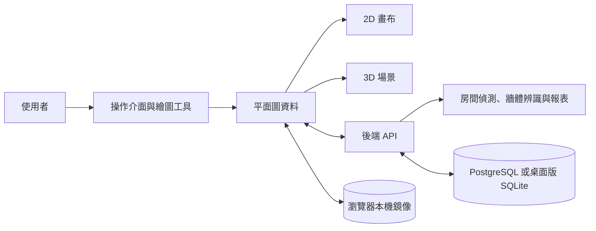

# interiordesign

用 2D 平面圖規劃室內空間，再以 3D 預覽設計成果。

## 最近更新
<!-- readme:recent 自動產生，不要手改 -->
- [2026-11-15](docs/worklog/2026-11-15.md)：docs(readme): 更新最近更新
- [2026-11-13](docs/worklog/2026-11-13.md)：docs(readme): 改版（舊版搬到 docs/）
- [2026-11-02](docs/worklog/2026-11-02.md)：行走模式三個操作錯：分割畫面鍵盤給 3D、Q／E 不轉家具、方向鍵能走能轉身；審查建議：行走時 Delete 不刪看不到的選取、Q／E 鍵燈不亮、說明與規格補方向鍵
- [2026-11-01](docs/worklog/2026-11-01.md)：修正行走模式，改成按住滑鼠左鍵拖曳轉頭，放開後即可切換分頁，按一次 Esc 就能退出；修復衛浴淋浴區閃爍，以及 3D 畫面調整畫質或視窗大小時偶爾閃黑的問題
- [2026-10-29](docs/worklog/2026-10-29.md)：房間會依家具辨識用途，並提示缺少的設備；自行命名的房間保留原名；空白平面圖新增開始引導，畫出第一間房時自動拉近，並減少畫面上重疊的標籤
- [2026-10-28](docs/worklog/2026-10-28.md)：重新調整 2D 與 3D 的移動、旋轉及縮放手感，並加入操作靈敏度設定與自由擺放功能；改善照明效果：2D 照度圖會考慮牆壁遮光與門窗透光，3D 燈光會照亮空間並投下陰影
- [2026-10-23](docs/worklog/2026-10-23.md)：整理軟體盤點結果，完成使用者選定的介面、照明與效能改善；修正頂列擁擠、側邊面板重疊、縮放被面板遮擋及存檔後重新整理找不到方案等問題
<!-- /readme:recent -->

## 這是什麼
<!-- readme:about 2026-11-13 -->
Interior Designer 是一套室內設計繪圖工具，適合想規劃房間格局、家具與照明配置的人使用。可以畫牆、門窗和房間，擺放家具與水電設備，標註尺寸，並切換到 3D 查看空間。

工具支援房間面積計算、照度分析、空間健檢及第一人稱行走，也能匯出圖面、報表和 3D 模型。除了瀏覽器版本，另有使用本機資料庫的桌面版。

目前已有完整的繪圖、預覽與匯出功能，近期持續改善行走操作、3D 效能與空間健檢。工作紀錄中仍列有廚房與陽台之間的牆面落差待處理。
<!-- /readme:about -->

## 架構
<!-- readme:arch 2026-11-13 -->
前端是使用者操作的地方：介面提供工具與設定，編輯器管理平面圖資料，再把結果畫成 2D 畫布與 3D 場景。

後端處理專案儲存、房間偵測、底圖牆體辨識和報表。伺服器版使用 PostgreSQL；桌面版在本機執行，使用 SQLite。前端離線時仍可繪圖並存到瀏覽器，連線後再補送。



| 資料夾 | 放什麼 |
|---|---|
| `client/src/model` | 平面圖資料格式、型錄與版本轉換 |
| `client/src/core` | 編輯、幾何計算、家具與 3D 等核心功能 |
| `client/src/tools` | 繪圖、選取、放置與校準工具 |
| `client/src/ui` | 操作介面、面板、引導與自動存檔 |
| `client/src/net` | 前端 API 與儲存相關程式 |
| `client/src/data` | 家具、電氣與配置資料 |
| `client/public/textures` | 材質貼圖 |
| `client/test` | 前端測試 |
| `server/app` | 後端 API、資料庫、辨識與報表 |
| `server/tests` | 後端測試 |
| `schema` | 平面圖資料格式定義 |
| `bench` | 效能與功能驗證腳本 |
| `scripts`、`tools` | 資料處理、資源及專案檢查工具 |
| `docs` | 設計規則、規格與工作紀錄 |
| `docker`、`packaging` | 容器啟動與安裝程式設定 |
<!-- /readme:arch -->

## 怎麼跑
<!-- readme:run 2026-11-13 -->
本機開發需要 Node.js 20 以上、Python 3.11 以上及 PostgreSQL。安裝依賴並建立資料庫後，啟動前端與後端：

```bash
npm install
npm run setup:py
createdb interior_design
npm run dev
```

開啟 http://localhost:5180。若需要額外的家具模型，可執行 `npm run assets`；不下載時仍可使用，但部分家具會以簡化形狀顯示。

使用 Docker 啟動：

```bash
docker compose up --build
```

開啟 http://localhost:18791。需要熱重載的開發模式可執行：

```bash
docker compose -f docker-compose.dev.yml up --build
```

開啟 http://localhost:5180。

執行型別檢查、資料格式產生結果檢查，以及前後端測試：

```bash
npm test
```

完整驗收需先啟動 `npm run dev`，再執行：

```bash
npm run verify:all
```

桌面版須在目標平台上建置：

```bash
./build-desktop.sh
```

Windows 使用：

```bat
build-desktop.bat
```
<!-- /readme:run -->

## 工作日誌
每天做了什麼在 [`docs/worklog/`](docs/worklog/)，一天一份，檔名就是日期。
舊版 README：[`docs/README-舊版.md`](docs/README-舊版.md)

<!-- 標記外面的內容不會被自動覆寫 -->
