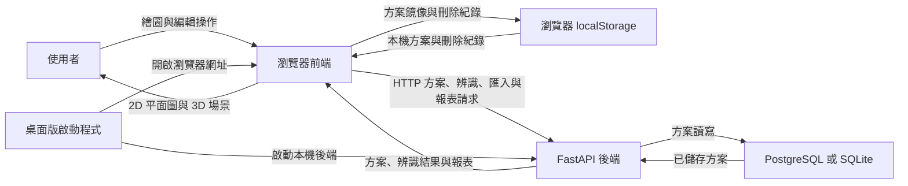
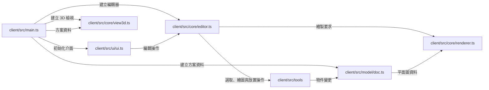
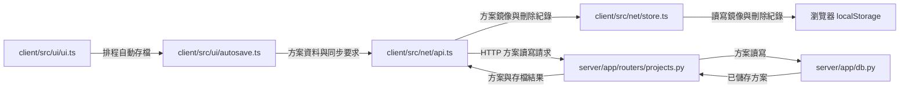
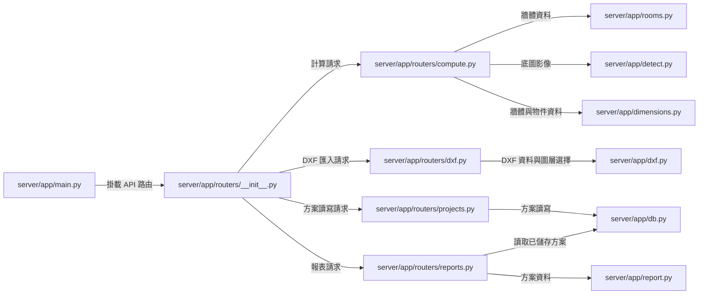

# interiordesign

用 2D 平面圖規劃室內空間，再以 3D 預覽設計成果。

## 最近更新
<!-- readme:recent 自動產生，不要手改 -->
- [2026-11-20](docs/worklog/2026-11-20.md)：docs(readme): 更新最近更新；docs(readme): 重寫說明與架構
- [2026-11-19](docs/worklog/2026-11-19.md)：建立跨平台自動檢查，讓專案在乾淨的 Linux 環境驗證測試、型別與建置；補上後端測試所需的資料庫，並修正乾淨環境中會造成檢查失敗的規則
- [2026-11-18](docs/worklog/2026-11-18.md)：docs(readme): 更新最近更新
- [2026-11-17](docs/worklog/2026-11-17.md)：docs(readme): 更新最近更新
- [2026-11-16](docs/worklog/2026-11-16.md)：更新專案說明文件，整理近期變更；重寫系統架構說明，加入整體與子系統圖，並核對實際程式碼
- [2026-11-15](docs/worklog/2026-11-15.md)：docs(readme): 更新最近更新
- [2026-11-13](docs/worklog/2026-11-13.md)：docs(readme): 改版（舊版搬到 docs/）
<!-- /readme:recent -->

## 這是什麼
<!-- readme:about 2026-11-20 -->
Interior Designer 適合想規劃房間格局、家具和照明配置的人。可以畫牆、門窗與房間，擺放家具和水電設備，標註尺寸，再切換到 3D 查看空間。

工具支援房間面積計算、照度分析、空間健檢與第一人稱行走，也能匯出圖面、報表和 3D 模型。除了瀏覽器版本，也有使用本機資料庫的桌面版。

目前已有繪圖、預覽和匯出功能，近期持續改善行走操作、3D 效能與空間健檢。工作紀錄中仍列有廚房與陽台之間的牆面落差待處理。
<!-- /readme:about -->

## 架構
<!-- readme:arch 2026-11-20 -->
前端負責讓使用者畫圖和編輯：介面將操作交給編輯器，編輯器更新方案資料，再把結果畫成 2D 平面圖或 3D 場景。

FastAPI 後端負責方案儲存、牆體和房間辨識、尺寸鏈、DXF 匯入與報表。一般伺服器版使用 PostgreSQL；桌面版在本機啟動後端、使用 SQLite，並以瀏覽器顯示畫面。

瀏覽器也會保留方案的本機鏡像。離線時可繼續編輯，恢復連線後會補送尚未同步的變更。



### 前端編輯與顯示



### 存檔與同步



### 後端處理



| 資料夾 | 放什麼 |
|---|---|
| `client/src` | 前端入口、編輯器、資料模型、工具與介面 |
| `client/public` | 前端靜態資源與材質貼圖 |
| `client/test` | 前端測試 |
| `server/app` | 後端 API、資料庫存取、辨識與報表 |
| `server/scripts` | 資料遷移與版本回填腳本 |
| `server/tests` | 後端測試 |
| `schema` | 產生的平面圖資料格式定義 |
| `bench` | 效能與功能驗證腳本 |
| `scripts` | 資料處理、資源下載與程式產生腳本 |
| `tools` | 專案檢查工具 |
| `docs` | 設計規則、規格與工作紀錄 |
| `docs/worklog` | 每日工作日誌 |
| `docker` | 容器啟動設定 |
| `packaging` | 安裝程式設定 |
<!-- /readme:arch -->

## 怎麼跑
<!-- readme:run 2026-11-20 -->
本機開發需要 Node.js 20 以上、Python 3.11 以上及 PostgreSQL。安裝依賴並建立資料庫後，啟動前端與後端：

```bash
npm install
npm run setup:py
createdb interior_design
npm run dev
```

開啟 http://localhost:5180。若需要額外的家具模型，可執行 `npm run assets`；未下載時部分家具會以簡化形狀顯示。

使用 Docker 啟動：

```bash
docker compose up --build
```

開啟 http://localhost:18791。需要熱重載的開發模式可執行：

```bash
docker compose -f docker-compose.dev.yml up --build
```

開啟 http://localhost:5180。

執行型別檢查、資料格式產生結果檢查，以及前後端測試：

```bash
npm test
```

完整驗收需先啟動 `npm run dev`，再執行：

```bash
npm run verify:all
```

桌面版須在目標平台上建置。macOS 或 Linux：

```bash
./build-desktop.sh
```

Windows：

```bat
build-desktop.bat
```
<!-- /readme:run -->

## 工作日誌
每天做了什麼在 [`docs/worklog/`](docs/worklog/)，一天一份，檔名就是日期。
舊版 README：[`docs/README-舊版.md`](docs/README-舊版.md)

<!-- 標記外面的內容不會被自動覆寫 -->
